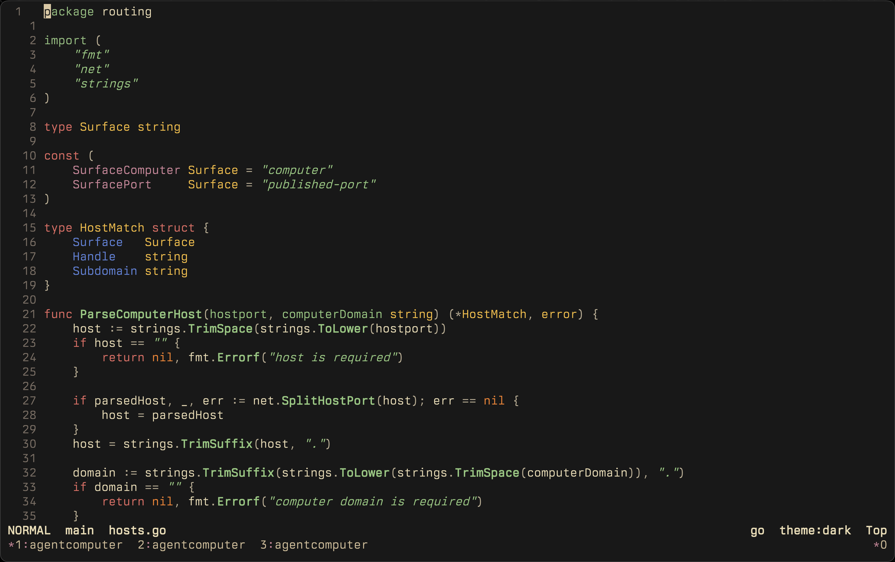
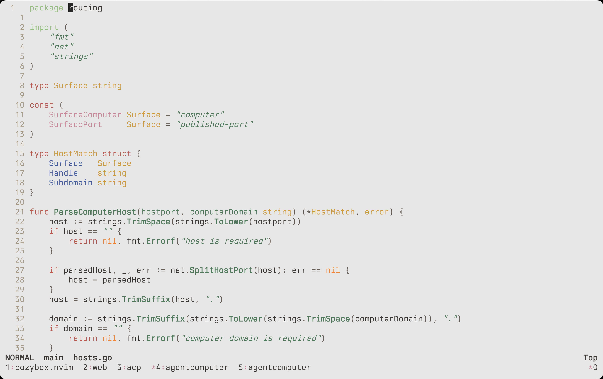

# cozybox.nvim

A darker gruvbox with blue accents, a softer red, and a light mode.

## Dark


## Light


## Use

```vim
colorscheme cozybox       " dark
colorscheme cozybox-light " light
```

There are no options. To change a colour, edit the palette in `lua/cozybox.lua`.
